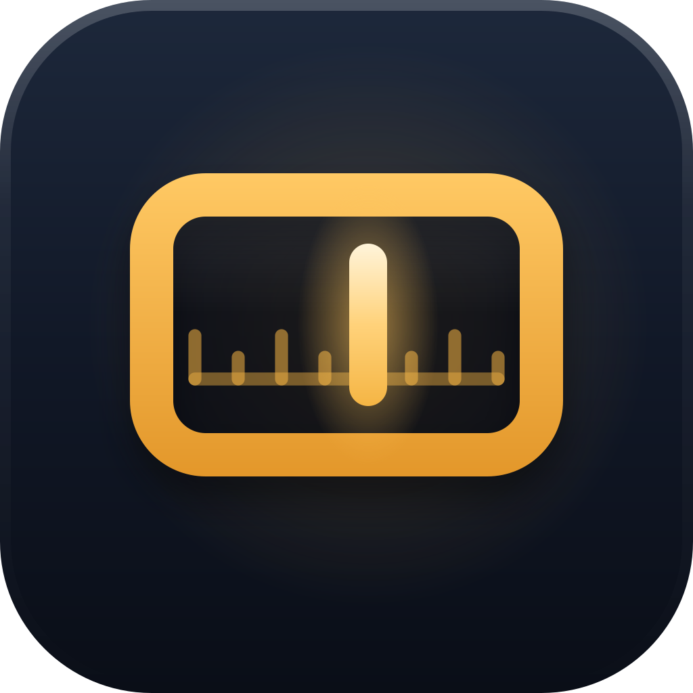
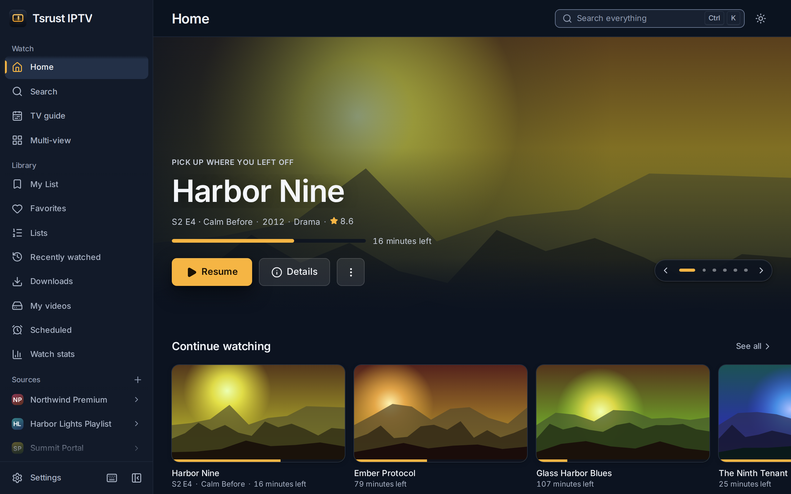
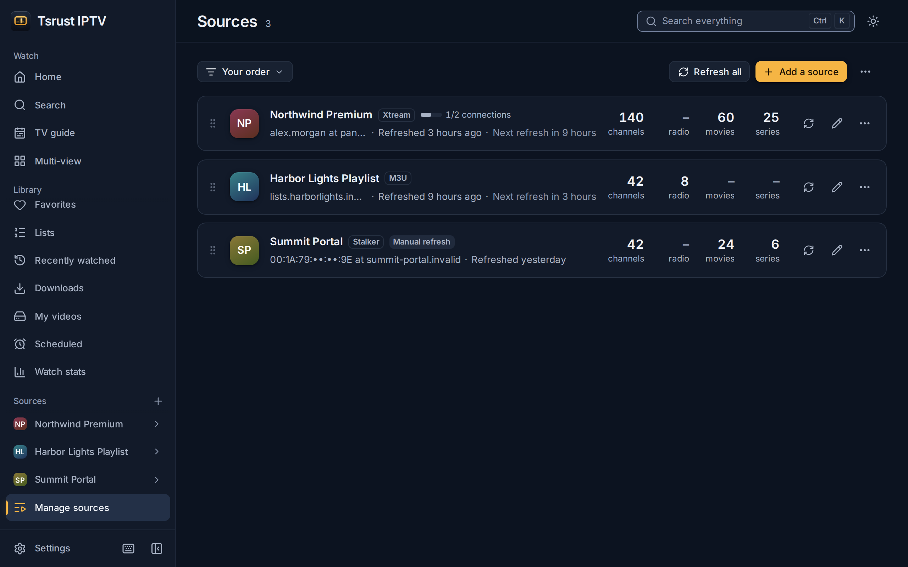
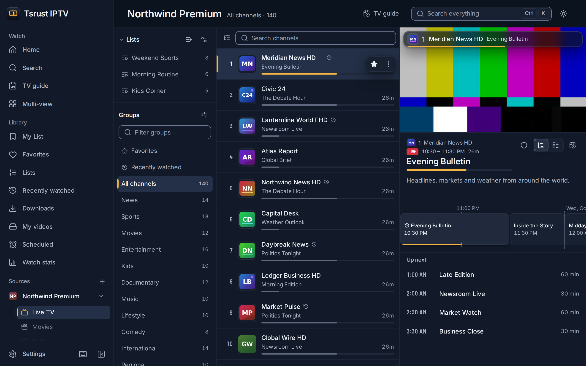
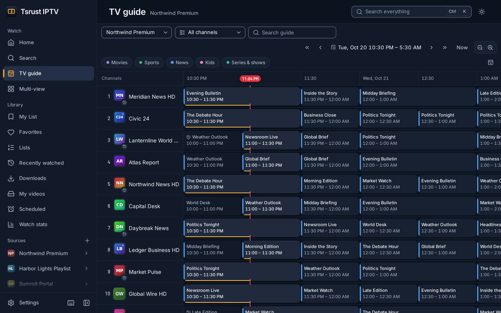
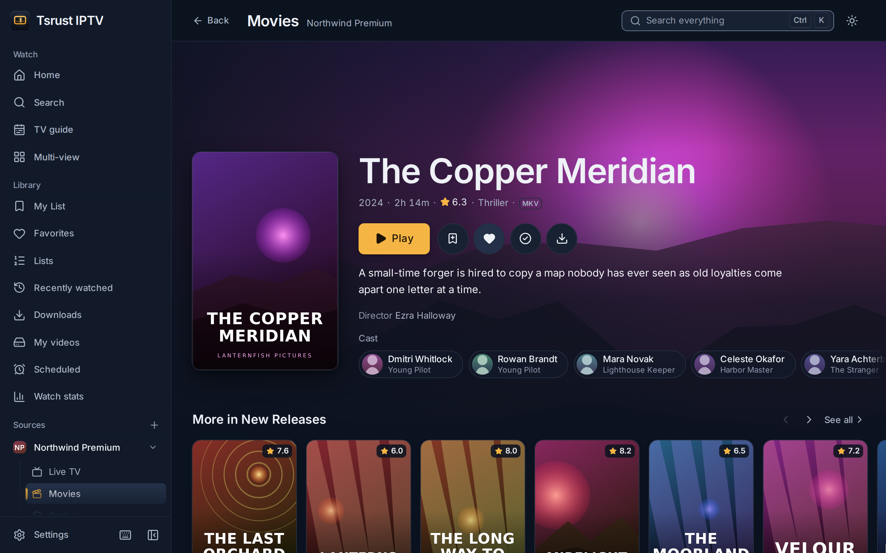
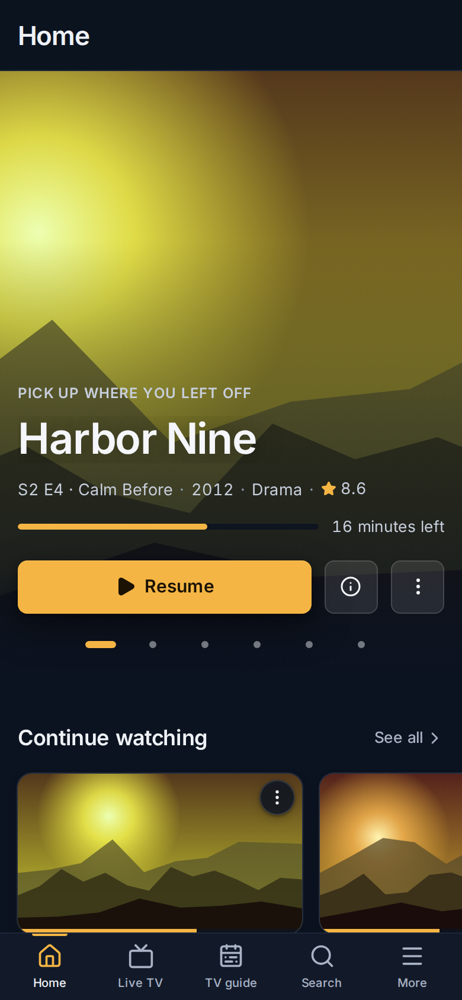

<p align="center">
  
</p>

<h1 align="center">Tsrust IPTV</h1>

<p align="center">
  Watch your own M3U playlists, Xtream Codes accounts and Stalker portals on Windows or in a browser, with a full TV guide, movies and series, recording and a phone remote.
</p>

<p align="center">
  <a href="https://github.com/philly0105/Rust-IPTV/releases/latest">Download for Windows</a>
  ·
  <a href="#run-the-server-with-docker">Run the server with Docker</a>
  ·
  <a href="docs/user-guide.md">User guide</a>
</p>

<p align="center">
  <a href="https://github.com/philly0105/Rust-IPTV/actions/workflows/ci.yml"></a>
</p>



No channels, films or other content come with the app. It plays the sources you add.

## Download

### Windows

Get the `..._x64-setup.exe` installer from the [latest release](https://github.com/philly0105/Rust-IPTV/releases/latest) and run it. It installs for your user account only and needs no administrator rights. The app draws its window with Microsoft's WebView2 runtime, which Windows 11 includes; where it is missing, the installer downloads it.

The installer is not code-signed yet, so Windows SmartScreen may say "Windows protected your PC". Choose More info, then Run anyway.

For playback inside the window through mpv, install mpv (WinGet, Scoop or Chocolatey) or point Settings > External players at it. Without mpv, everything plays in the built-in player.

### Run the server with Docker

The server runs the same app for browsers, on amd64 and arm64:

```sh
docker run -d --name tsrust-iptv --restart unless-stopped \
  -p 127.0.0.1:7180:7180 -v tsrust-iptv-data:/data \
  ghcr.io/philly0105/tsrust-iptv:latest
```

Then open http://127.0.0.1:7180 on the same machine. To use it from phones, tablets and TVs, see [Self-hosting](#self-hosting).

## Quick start

1. Install the app, or start the container and open it in your browser.
2. Add a source: paste a playlist URL (or choose an M3U file), enter an Xtream server, username and password, or a Stalker portal address and MAC.
3. Open Live TV and pick a channel, or open the TV guide. A three-step tour shows you Live TV, My List and search.



## What you can do

### Watch live TV and use the guide

- Zap with channel numbers, Page Up and Page Down, B for the last channel, and a history of the last ten.
- Browse the TV guide by day and time, zoom it, and search programme titles for the next 14 days. Xtream channels without XMLTV data show the provider's own now and next.
- Catch up on past programmes from a channel's archive, by programme or, without a guide, by the hour.
- When a channel stops working, the player switches to the same channel on another of your sources, with Undo.
- Make your own channel lists across sources, and rename or hide channels without changing the provider's data.





### Watch movies and series

- Pick up where you stopped; an Up next card starts the next episode.
- Filter by decade or year, tick off what you watched, and hide it.
- Episodes in M3U playlists are grouped into series and seasons, like Xtream and Stalker series.
- With your own TMDB API key, detail pages show plots, cast, trailers, ratings and similar titles.



### Control playback

- The built-in player handles HLS, MPEG-TS and DASH, including ClearKey-protected M3U channels. On Windows, mpv can play inside the window, and mpv or VLC can run as external players.
- Set aspect ratio, crop and zoom; load subtitle files and style them; shift subtitles and audio in 100 ms steps; see the stream's codecs and bitrates.
- A sleep timer that fades out, picture-in-picture, and screenshots with S.

### Keep a library

- My List for movies and series to watch later, favorites, and recently watched.
- Download movies, episodes, whole seasons and past programmes, and watch them offline in My Videos.
- Watch stats: time watched per day and your most watched channels and titles, kept on your device.
- Backups in IPTVnator's format, so you can bring your playlists, favorites and positions over from IPTVnator.

### Watch several channels at once

Multi-view plays two to four live channels side by side, in a grid of four, or one large and three small. Only the tile you choose has sound, and the page warns when a source allows fewer connections than you have tiles.

### Record and get reminded

Record a programme or a whole series from the guide, or the next 30 minutes to 3 hours of a channel. Recordings run without the player, with padding and retries, whenever the app is running, also from the tray. Reminders show a notification a few minutes before a programme starts, with a button to watch it.

### Use a remote or a phone

- A web remote in another browser tab, or on your phone after scanning a QR code in the desktop app: change channels, type a number, play, pause, seek and set the volume.
- On phones and narrow windows, a layout with a hideable sidebar, a compact mini player and tap-to-show controls.



### Lock content and keep your data private

- Parental controls: a PIN locks groups, channels, movies and series, and adult groups can be locked automatically. Locked content is either hidden or asks for the PIN.
- No telemetry and no account. See [Privacy](#privacy).

The interface is in 19 languages, has light, dark and OLED themes with seven accent colours, and works from the keyboard (Ctrl+K opens the command palette, `?` lists the shortcuts).

## Privacy

Tsrust IPTV has no telemetry, analytics, crash reporting, ads or account, and it does not check for updates. It connects to:

- Your providers: the playlist, guide and portal addresses you enter, and the streams, logos and posters they list. Xtream accounts send VLC's User-Agent unless you set your own request headers.
- TMDB, only after you turn it on in Settings > Metadata with your own API key. TMDB then receives your key, your interface language, and the titles and years of the movies and series you open or point at, plus requests for its trending list. Posters and backdrops come from TMDB's image server.
- YouTube's privacy-enhanced player (youtube-nocookie.com), only when you play a trailer.

Everything else stays on your computer or your server: sources and their logins, favorites, history, watch stats, settings, the image cache and the logs, in which secrets are redacted. Backups leave passwords out unless you ask for them.

## Self-hosting

`iptv-server` (the Docker image above) serves the interface to any browser and keeps your data in one volume. It has no login, and over plain `http://` on your network browsers turn off the install button, copy buttons, notifications and ClearKey playback. [deploy/](deploy/README.md) runs it behind Caddy with HTTPS and a password, for your home network or a public domain, in a few steps.

## Documentation

- [User guide](docs/user-guide.md): every feature, keyboard shortcuts, backups, troubleshooting
- [Deploying the server](deploy/README.md)
- [Architecture](docs/README.md): one document per subsystem
- [Changelog](CHANGELOG.md)
- [Contributing](CONTRIBUTING.md)
- [Security policy](SECURITY.md)

## Development

The app is a Tauri 2 desktop shell and an axum web server around one Rust core, with a React and TypeScript interface. You need Rust 1.90 or newer, Node 24 with pnpm 10 (`corepack enable`), and Windows for the desktop app; the core and the server also build on Linux.

```sh
pnpm install
pnpm tauri:dev   # the desktop app with hot reload
pnpm mock        # sample Xtream, Stalker, M3U and XMLTV sources on port 7290
pnpm check       # typecheck, unit tests, cargo test, clippy and rustfmt
```

[CONTRIBUTING.md](CONTRIBUTING.md) covers every command, the end-to-end and screenshot tooling, CI, style and releases.

## Credits

Tsrust IPTV was rebuilt from [IPTVnator](https://github.com/4gray/iptvnator) by 4gray, which is MIT-licensed. Each release includes `THIRD_PARTY_NOTICES.md` with the licences of IPTVnator and of the npm packages and Rust crates the app is built from.

This product uses the TMDB API but is not endorsed or certified by TMDB.

<!--
Licence: the owner has not chosen one yet. Add the licence line here, and a LICENSE file at the
repository root, once decided. Until then the workspace Cargo.toml's `license = "MIT"` is only a
placeholder, and the Docker image has no org.opencontainers.image.licenses label.
-->
